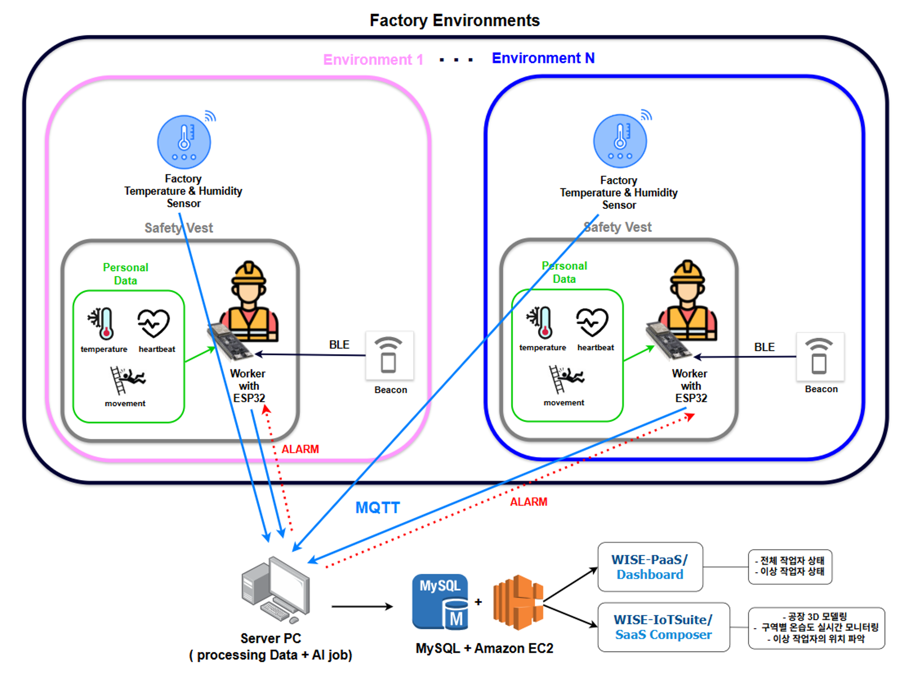
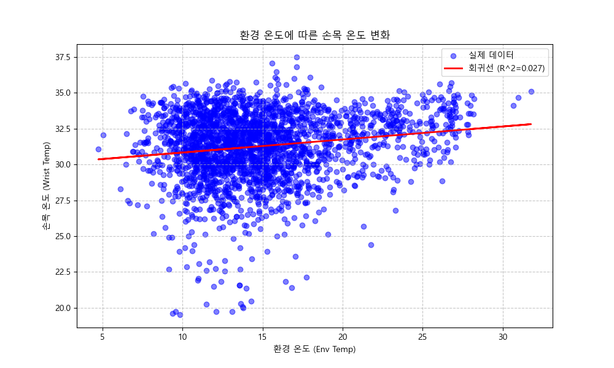

# 스마트 산업용 안전 조끼: 작업자 안전 토탈 케어 시스템

2025 Advantech AIoT InnoWorks 최우수상. 팀 안전쫓기 (최홍석, 정세연, 신아현, 한서진)

## 개요

고용노동부 2025년 2분기 산업재해 통계에서 떨어짐(낙상)은 사망 원인 1위로 전체의 34.1%를 차지한다.
여름철 폭염에 따른 온열질환도 작업자를 위협한다. 근로복지공단 자료 기준 최근 6년간 온열질환으로 승인된 산업재해는 147건이고, 이 중 22건이 사망 사고였다.

두 가지 위험은 대응에 필요한 시간이 다르다.
낙상은 지면에 닿기 전까지 밀리초 안에 조치해야 하고, 온열질환은 수 초 주기로 상태를 관찰하면 된다.
이 차이를 그대로 시스템 구조에 반영했다. 낙상 판정은 조끼 위에서 끝내고, 건강 상태 분류는 서버가 맡는다.

## 시스템 구성



구역마다 온습도 센서와 BLE 비콘을 두고, 작업자는 ESP32가 달린 조끼를 입는다.
조끼는 체온, 심박, 움직임을 측정하면서 주변 비콘을 스캔해 자신의 위치를 파악하고, 이 값들을 MQTT로 서버에 올린다.
서버 PC가 구역 온습도와 작업자 생체 데이터를 결합해 이상 여부를 판정하고, 위험하면 해당 조끼로 경보를 되돌려 보낸다.
판정 결과는 EC2 위의 MySQL에 쌓여 WISE-PaaS Dashboard와 WISE-IoTSuite/SaaS Composer로 시각화된다.

또한, 작업자의 조끼에서 감지되는 낙상은 즉시 작업자 조끼 내부의 mcu(edge-level)를 통해 에어백을 전개시켜 낙상으로부터 작업자를 보호한다.

## 낙상 감지

에어백은 낙상이 시작된 뒤 지면에 닿기 전에 터져야 의미가 있다.
센서 값을 서버로 올려 판정을 받아오면 MQTT 왕복만으로 이 예산을 넘긴다.
그래서 판정을 MCU 안에서 끝냈다.

scikit-learn으로 학습한 Random Forest를 [micromlgen](https://github.com/eloquentarduino/micromlgen)으로 C++ 중첩 조건문으로 변환해
헤더 파일 하나(`rf_model_big.h`)로 만들고 펌웨어에 정적 링크했다.
추론 중에 동적 할당도, 외부 통신도 없다.

| 항목 | 값 |
|---|---|
| 입력 | 가속도 3축 + 각속도 3축, 50샘플 슬라이딩 윈도우 (300차원) |
| 모델 | Random Forest, 15 트리 |
| 추론 주기 | 10샘플마다 |
| 판정 조건 | 15개 트리 전원이 낙상에 투표 |
| 전개 후 | 5초 유지 뒤 서보 복귀, 감지 잠금 자동 해제 |

임계값을 만장일치로 잡은 건 의도적이다.
에어백 오발은 카트리지 소모와 작업 방해로 바로 이어지기 때문에, 미검출보다 오검출의 비용이 크다고 봤다.
전개 후에는 서보가 원위치로 돌아가며 자동 재장전되므로 카트리지만 갈아 끼우면 조끼는 계속 쓸 수 있다.

## 통신 구조(mqtt)

작업자 조끼 내의 통신(esp-now) 외에는 mqtt 통신을 통해 산업현장에서 안정적으로 데이터가 전송된다.

| 토픽 | 방향 | 주기 | 페이로드 |
|---|---|---|---|
| `vest/data` | 조끼 → 서버 | 5초 (낙상 시 즉시) | `mcu_id`, `body_temp`, `hr`, `beacons[{major, minor, rssi}]`, `is_fell` |
| `env/data` | 환경 노드 → 서버 | 5초 | `mcu_id`, `temperature`, `humidity`, `beacon_major`, `beacon_minor` |
| `vest/alert/<MAC>` | 서버 → 조끼 | 이벤트 | `ALERT` / `NORMAL` |

서버는 환경 노드가 보낸 `beacon_major-minor`를 키로 구역별 온습도를 캐싱한다(TTL 300초).
작업자 위치는 조끼가 스캔한 비콘 중 RSSI가 가장 강한 것으로 정한다.

## 건강 상태 분류

정상 상태만으로 학습할 수 있는 Isolation Forest를 1차 판별기로 두고,
이상으로 걸러진 표본에만 규칙 기반 분류기를 적용해 병명을 붙이는 2단 구조로 갔다.

규칙에 들어가는 환경 보정 계수는 임의로 정하지 않고 학습 데이터에서 회귀로 뽑았다.
환경 온도에 대한 손목 온도의 회귀 기울기가 `0.09073`이고, 이 값을 임계식에 그대로 쓴다.



1차에서 정상으로 나오면 거기서 끝난다. 이상으로 걸러진 경우에만 아래 규칙을 위에서부터 순서대로 평가한다.

```
effective_env_temp = 환경온도 ≥ 25°C 이면 체감온도표 조회값, 아니면 환경온도

저체온증 위험       env_temp ≤ 4.0  and  body_temp ≤ 0.09073 · env_temp + 33.0
일사병 위험         effective_env_temp ≥ 31.0  and  body_temp ≥ 0.09073 · effective + 35.0
저체온 및 서맥      body_temp ≤ 33  and  hr < 50
고체온 및 빈맥      body_temp ≥ 35  and  hr > 100
저체온 / 고체온     body_temp ≤ 33  /  ≥ 35
서맥 / 빈맥         hr < 50  /  hr > 100
그 외              정상 (환경 적응에 의한 변동으로 간주)
```

체감온도는 기온 25\~40°C, 습도 25\~100% 구간의 조회표로 계산한다. 각 임계값의 근거는 다음과 같다.

| 값 | 근거 |
|---|---|
| `31.0°C` | 산업안전보건공단 온열질환 예방조치 기준 체감온도 |
| `4.0°C` | 한랭작업환경 관리지침(W-17-2015) 보호구 착용 기준 |
| `33 / 35°C` | 심부체온 기준(저체온증 35 이하, 일사병 37\~40)을 손목 표면온도로 약 2°C 보정 |
| `50 / 100 bpm` | 서맥 · 빈맥 임상 기준 |
| `0.09073` | 학습 데이터에서 구한 환경 온도 대비 손목 온도 회귀 기울기 |

## 검증

`testing/make_tc.py`는 위 규칙의 모든 분기를 하나씩 활성화하는 입력을 역산해 2,900건의 검증 세트를 만든다.
정상 500건과 위험 8개 유형 각 300건으로 구성된다.
조건식이 바뀌면 생성 로직도 따라가도록 규칙 함수를 서버 코드와 공유한다.

`testing/test_accuracy.py`가 이 세트로 1차와 2차를 모두 통과한 최종 판정을 평가하고 혼동행렬과 ROC 곡선을 낸다.

| 지표 | 값 |
|---|---|
| 낙상 감지 민감도 | 92.8% |
| 낙상 판정 소요 시간 | 약 0.09초 |
| 건강 이상 탐지 민감도 | 80.7% |

## 하드웨어

| 역할 | 부품 | 인터페이스 |
|---|---|---|
| MCU | ESP32-S3-DevKitC-1-N8R8 | |
| 체온 | MLX90614ESF 비접촉 적외선 온도센서 | I2C |
| 심박 | PulseSensor | ADC |
| 자세·충격 | MPU-9250 9축 IMU | I2C |
| 환경 | DHT22 (AM2302) 온습도 | 1-Wire |
| 위치 | BLE iBeacon | BLE Advertising |
| 경보 | 액티브 부저 | GPIO |
| 에어백 | 서보모터 + CO2 인플레이터 (25g 카트리지) | PWM |

조끼 한 벌에 MCU가 두 개 들어간다. 생체 센싱과 통신을 맡는 쪽, 낙상 감지와 에어백 구동을 맡는 쪽이다.
환경 노드는 구역 수만큼 두며, 같은 펌웨어에서 `MY_BEACON_MAJOR` / `MY_BEACON_MINOR`만 바꿔 업로드한다.

## 저장소 구조

```
firmware/
  mqtt_sender/      조끼 MCU 1 · 생체 센싱, BLE 스캔, MQTT, 부저
  env_sensor/       환경 노드 · DHT22 온습도 발행
  rf_model/         조끼 MCU 2 · IMU 수집, 온디바이스 추론, 에어백 구동
    rf_model_big.h  C++로 변환된 Random Forest (15 트리)
server/
  mqtt_listener.py  MQTT 구독, 위치 매핑, 하이브리드 분류, DB 적재
  model.joblib      Isolation Forest
  scaler.joblib     StandardScaler
training/
  train_model.py         Isolation Forest 학습
  analyze_regression.py  환경 온습도와 체온의 상관·회귀 분석
testing/
  make_tc.py        분기 전수 커버 테스트셋 생성
  test_accuracy.py  혼동행렬 · ROC 평가
data/
  full_coverage_cases.csv  생성된 검증 세트 (2,900행)
  README.md                학습 데이터셋을 받아 두는 위치와 사용 컬럼 안내
docs/               아키텍처 도식, 분석 산출 이미지
```

## 실행

### 서버

```bash
pip install -r requirements.txt

export DB_HOST=<mysql-host>
export DB_USER=<user>
export DB_PASSWORD=<password>

cd server && python mqtt_listener.py
```

`worker_status`(현재 상태 upsert)와 `vest_log`(이력 적재) 테이블은 최초 실행 시 자동 생성된다.

### 모델 재학습과 검증

```bash
cd training
python train_model.py          # ../server/ 에 joblib 2개 생성
python analyze_regression.py   # ../docs/ 에 상관·회귀 그래프 생성

cd ../testing
python make_tc.py
python test_accuracy.py
```

### 펌웨어

Arduino IDE에서 각 스케치 폴더를 열어 업로드한다.

```
firmware/rf_model/rf_model.ino        조끼 MCU 2 (낙상·에어백)
firmware/mqtt_sender/mqtt_sender.ino  조끼 MCU 1 (센싱·통신)
firmware/env_sensor/env_sensor.ino    환경 노드 (비콘 ID를 바꿔가며 구역 수만큼)
```

필요 라이브러리는 `PulseSensorPlayground`, `PubSubClient`, `ArduinoJson`, `Adafruit_MLX90614`, `DHT sensor library`, `MPU9250`, `ESP32Servo`.

WiFi 자격증명은 각 `.ino` 상단의 `YOUR_WIFI_SSID` / `YOUR_WIFI_PASSWORD`를 교체한다.
ESP-NOW는 송수신 노드의 채널이 같아야 하며 현재 6번으로 고정되어 있다.
낙상 MCU의 `receiverMac[]`에는 조끼 MCU의 MAC을 넣는다.
